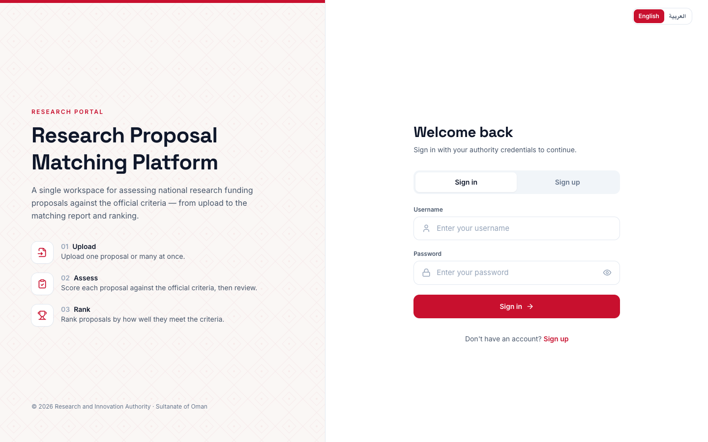

# Ministry of Research — Innovation Authority

**Research Proposal Matching Platform** for the Research and Innovation Authority, Sultanate of Oman.

A single workspace for reviewing national research funding proposals, from submission through matching to final evaluation:

1. **Intake**: submit and filter funding proposals in one place.
2. **Match**: compare proposals against the national research publication record.
3. **Evaluate**: score proposals across three evaluation themes aligned with Oman Vision 2040.

## Login page



The login page has a branded panel (logo, platform overview, workflow steps) on the left and the sign-in form on the right. On phones and narrow screens the branded panel is hidden and the logo appears above the form.

- **Sign in** with a username or email and a password. A plain username also matches an account registered as `username@ria.gov.om`.
- **Sign up** with an email and a password. The new user is signed in straight away.
- The password field has a show/hide toggle, and errors are shown above the form.

The page is in [`src/views/Login.tsx`](src/views/Login.tsx) and the logo is in [`public/images/ria-logo.png`](public/images/ria-logo.png).

## Tech stack

| Part | Built with |
|---|---|
| Frontend | [React 18](https://react.dev/) + TypeScript, [Vite](https://vitejs.dev/), [Tailwind CSS](https://tailwindcss.com/), [lucide-react](https://lucide.dev/) icons |
| Backend | [Django 5.2](https://www.djangoproject.com/) + [Django REST Framework](https://www.django-rest-framework.org/), token authentication |
| Database | SQLite (default, for development) |
| AI analysis | [Claude](https://www.anthropic.com/) (Opus 5.5) through the Anthropic Python SDK |

## Getting started

You need **Node.js 18+** and **Python 3.11+**. Run the backend and the frontend in two terminals.

### 1. Backend (Django API on port 8000)

```bash
cd backend
python3 -m venv .venv
source .venv/bin/activate          # Windows: .venv\Scripts\activate
pip install -r requirements.txt
python manage.py migrate
python manage.py createsuperuser   # an admin account (staff see every proposal)
python manage.py runserver
```

### 2. Frontend (Vite on port 5173)

```bash
npm install
npm run dev
```

Open http://localhost:5173. In development Vite forwards every `/api` request to Django, so no extra configuration is needed.

The Django admin is at http://127.0.0.1:8000/admin/ for managing users and data.

## AI analysis

When `ANTHROPIC_API_KEY` is set in `backend/.env`, Claude helps reviewers at three points. Everything it produces is a suggestion that a person checks and can change.

| Step | What Claude does | Typical time |
|---|---|---|
| **Read the document** | Reads the uploaded PDF or TXT and fills in title, team, institution, research area, budget, date, abstract and keywords. Lists any fields the document doesn't state. | 5–10 s |
| **Match publications** | Compares the proposal with every publication by meaning, not exact words, and gives each a 0–100 relevance score with a one-sentence reason. | ~10 s |
| **Suggest scores** | Reads the full proposal and suggests a score and reason for every evaluation criterion (Appendix A, B, C), plus strengths, weaknesses and a funding recommendation. | 25–60 s |

- **Without a key** the app still works: reviewers fill in the form by hand and matching falls back to keyword overlap (20 points per shared keyword).
- **Status** (approved, rejected, and so on) is always set by a person.
- **Cost and limits:** each upload makes about 3 requests to the Anthropic API, which is billed per use. Each user can make 60 AI requests per hour (`AI_RATE_LIMIT`).
- **Privacy:** proposal documents are sent to Anthropic's API for analysis. Confirm this is allowed for your documents before turning AI on.
- The code is in [`backend/research/ai.py`](backend/research/ai.py).

## Access rules

- Every API endpoint except login and sign-up requires a signed-in user.
- **Proposals** are private to the person who submitted them. **Staff** users (`is_staff`) see all proposals.
- **Matches** follow their proposal: you see matches for the proposals you can see. Only the review fields (`status`, `reviewed_by`, `notes`) can be edited.
- **Publications** are a shared library for all signed-in users.
- **Evaluations**: each reviewer has one evaluation per proposal. Saving again updates it.

## API

All endpoints are under `/api/`. Send the token from login or sign-up as `Authorization: Token <token>`.

| Method | Endpoint | What it does |
|---|---|---|
| POST | `/auth/register/` | Create an account `{email, password}` and return `{token, user}` |
| POST | `/auth/login/` | Sign in `{username, password}` (username or email) and return `{token, user}` |
| POST | `/auth/logout/` | Revoke the token |
| GET | `/auth/me/` | The signed-in user |
| GET, POST | `/proposals/` | List or create proposals |
| GET, PATCH, DELETE | `/proposals/<id>/` | Read, update or delete a proposal (deleting also removes its matches and evaluations) |
| GET, POST | `/publications/` | List or create publications |
| GET, PATCH, DELETE | `/publications/<id>/` | Read, update or delete a publication |
| GET | `/matches/?proposal_id=<id>` | List matches with nested proposal and publication, best score first |
| PATCH | `/matches/<id>/` | Review a match (`status`, `reviewed_by`, `notes`) |
| POST | `/matches/generate/` | Run matching for all proposals and return `{count, method, warning}`, or for one with `{proposal_id}` and return its matches |
| GET, POST | `/evaluations/` | List your evaluations, or save one (created or updated per proposal) |
| GET | `/ai/status/` | Whether AI analysis is turned on, and which model |
| POST | `/ai/extract/` | Upload a proposal (`multipart`, field `file`, PDF or TXT) and get the extracted fields back |
| POST | `/ai/evaluate/` | Get suggested evaluation scores for `{proposal_id}` |

**Matching:** with AI on, Claude scores relevance by meaning and gives a reason; matches under 20% are left out. With AI off, a proposal and a publication match when they share keywords (20 points per shared keyword, up to 100). Running matching again refreshes scores but keeps review status and notes.

## Scripts

| Command | What it does |
|---|---|
| `npm run dev` | Start the frontend dev server |
| `npm run build` | Build the frontend into `dist/` |
| `npm run typecheck` | Run the TypeScript checks |
| `npm run lint` | Run ESLint |
| `python manage.py test research` | Run the backend tests (from `backend/`) |

## Project structure

```
backend/
  config/       Django settings and root URLs
  research/     Models, API views, serializers, matching engine, tests
src/
  views/        Pages: Login, Dashboard, Proposals, Publications, Matching
  components/   Header, Sidebar, ProposalWizard, shared UI
  lib/          API client (api.ts), data hooks, types, helpers
public/images/  Logos and images
docs/           Screenshots
```

## Environment variables

**Frontend** (`.env`, see [`.env.example`](.env.example)):

| Variable | Description |
|---|---|
| `VITE_API_URL` | Optional. The API's address when it is hosted on another domain. Leave empty in development. |

**Backend** (`backend/.env`, see [`backend/.env.example`](backend/.env.example)):

| Variable | Description |
|---|---|
| `DJANGO_DEBUG` | `true` for development, `false` in production |
| `DJANGO_SECRET_KEY` | Required when `DJANGO_DEBUG` is `false` |
| `DJANGO_ALLOWED_HOSTS` | Comma-separated host names the API answers on |
| `CORS_ALLOWED_ORIGINS` | Comma-separated frontend addresses allowed to call the API |
| `ANTHROPIC_API_KEY` | Turns on AI analysis. Leave empty to turn it off. |
| `ANTHROPIC_MODEL` | Claude model to use (default `claude-opus-5-5`) |
| `AI_RATE_LIMIT` | AI requests allowed per user (default `60/hour`) |

`.env`, `backend/.env` and the SQLite database are git-ignored. Never commit real credentials, especially the Anthropic API key.
